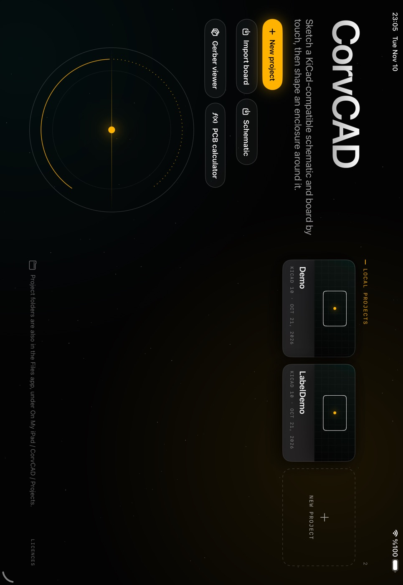
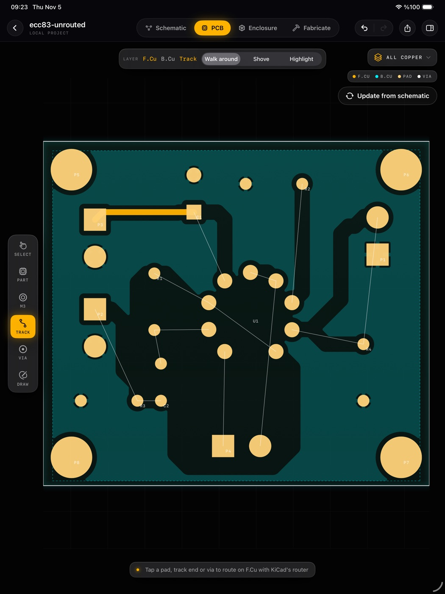
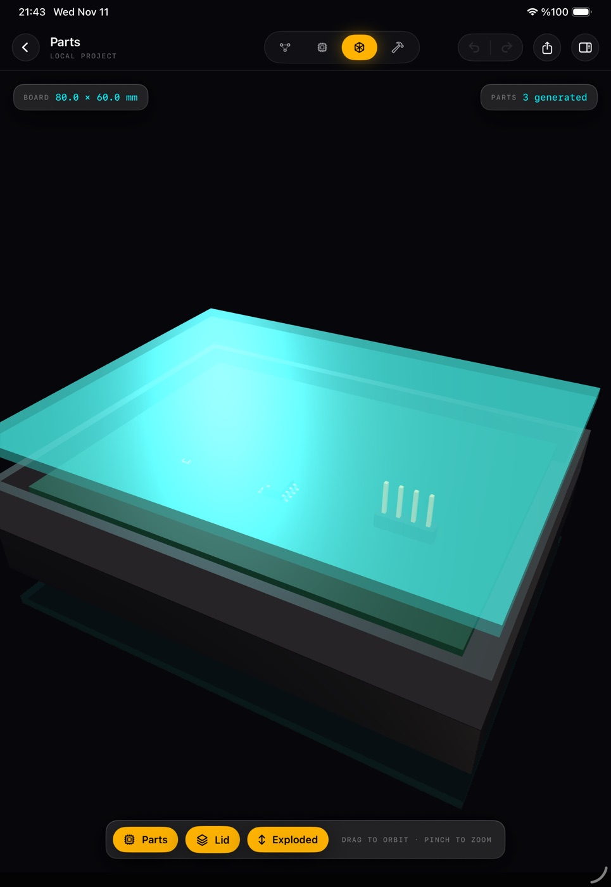
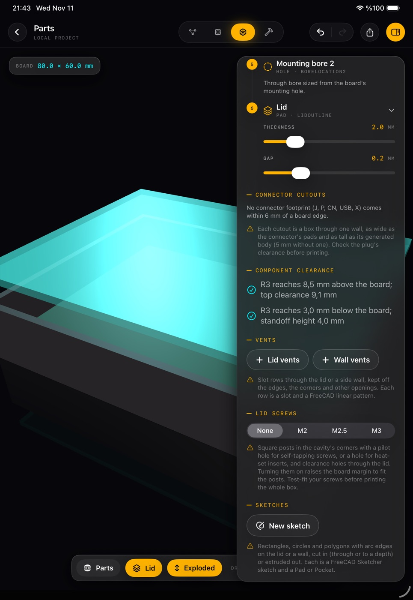

<h1 align="center">CorvCAD</h1>

<p align="center">
  <strong>From the first wire to the box that holds it.</strong><br>
  A touch-first workspace for iPad that carries an electronic design from schematic, to circuit board, to enclosure.<br>
  A <a href="https://corvusar.com">Corvusar</a> project.
</p>

<p align="center">
  
  
  
</p>

<table>
  <tr>
    <td width="50%"></td>
    <td width="50%"></td>
  </tr>
  <tr>
    <td align="center"><sub>Projects, tools and the Gerber viewer</sub></td>
    <td align="center"><sub>KiCad's own router, by touch (KiCad edition)</sub></td>
  </tr>
  <tr>
    <td></td>
    <td></td>
  </tr>
  <tr>
    <td align="center"><sub>Generated 3D parts on the board (FreeCAD edition)</sub></td>
    <td align="center"><sub>FreeCAD's feature timeline and clearance checks</sub></td>
  </tr>
</table>

## Contents

- [Scope](#scope)
- [Editions](#editions)
- [Features](#features)
- [Status](#status)
- [Getting started](#getting-started)
- [Repository layout](#repository-layout)
- [Documentation](#documentation)
- [Roadmap](#roadmap)
- [Contributing](#contributing)
- [Licensing](#licensing)
- [Trademarks](#trademarks)
- [Acknowledgements](#acknowledgements)

## Scope

A board is rarely the end of a design. It needs a schematic before it and a housing after it, and the two usually live in different programs on a desk. CorvCAD brings the whole path onto one iPad, in the formats engineers already use:

- **Electronics** in KiCad 10's own file format: `.kicad_pro`, `.kicad_sch`, `.kicad_pcb`. Projects open in desktop KiCad unchanged, and the reverse.
- **Mechanics** as an enclosure shaped around the board: a tray and lid, with cutouts, vents and screw posts. In the FreeCAD edition it is an editable FreeCAD document with exact solids.
- **Fabrication** from the same place: Gerbers and drill files for the board, STL, OBJ or STEP for the enclosure.

The portable C++ engine sits beneath a native SwiftUI and SceneKit app. Its C API is written so other front ends (macOS, Windows, Linux, Android) can follow; **none of them exists yet**.

CorvCAD is not a viewer, and not a remote desktop. In its native editions it compiles KiCad's and FreeCAD's own engines into the app. It is also not finished: see [Status](#status).

## Editions

One source tree builds three editions. Each adds to the one before it.

| Edition | Build flag | Licence | Adds |
|---|---|---|---|
| **Default** | none | MIT | CorvCAD's own engine: touch editing of KiCad projects, project libraries, a mesh enclosure, the Gerber viewer and the PCB calculator. |
| **KiCad** | `NATIVE_KICAD=YES` | GPL-3.0-or-later | KiCad 10.0.6's schematic and board engines, its libraries and its simulator. |
| **FreeCAD** | `NATIVE_FREECAD=YES` | GPL-3.0-or-later | FreeCAD 1.1.4's PartDesign enclosure, STEP, and generated 3D parts. |

Both flags together build one app with both engines.

## Features

### Electronics

| | Default | KiCad edition |
|---|:---:|:---:|
| Create, open and save KiCad 10 projects | ✓ | ✓ |
| Touch tools: parts, wires, labels, footprints, tracks, vias, zones, board outline, silkscreen and fab drawings | ✓ | ✓ |
| Hold menus: move, rotate, rename, delete, edit values and footprints; one undo history | ✓ | ✓ |
| Project symbol and footprint libraries, edited on a canvas | ✓ | ✓ |
| Update from schematic (pad nets) | ✓ | ✓ |
| KiCad's schematic model, hierarchy, buses, sheets, power rails, annotation | | ✓ |
| The official KiCad symbol and footprint libraries, with a part picker | | ✓ |
| KiCad's interactive router: walk around, shove, differential pairs, length and skew tuning | | ✓ |
| KiCad's DRC, ERC, zone fill, Board Setup and Update PCB from Schematic | | ✓ |
| Importers for Altium, Eagle, EasyEDA, CADSTAR, PADS, P-CAD, Fabmaster, LTspice and gEDA | | ✓ |
| SPICE simulation (ngspice), with **Electrify**: the board lit by its simulated voltages | | ✓ |
| Gerbers with job file, Excellon drill, placement, PDF/SVG plots, BOM and netlist | | ✓ |

### Mechanics

| | Default | FreeCAD edition |
|---|:---:|:---:|
| A tray and lid fitted to the board, with live 3D preview | ✓ | ✓ |
| STL and OBJ export | ✓ | ✓ |
| A FreeCAD PartDesign document, shown as its feature timeline | | ✓ |
| Connector cutouts, vent slot patterns, lid screw posts for screws or heat-set inserts | | ✓ |
| Sketch mode: rectangles, circles and polygons with arc edges, solved by FreeCAD's Sketcher, padded or pocketed | | ✓ |
| Mechanical-only projects, with no board | | ✓ |
| Components generated from their KiCad model names, and clearance checks against the lid and standoffs | placeholders | ✓ |
| Exact STEP and the editable `.FCStd` document | | ✓ |

### Everywhere

- **Gerber viewer**: RS-274X/X2 and Excellon, with layers stacked by function.
- **PCB calculator**: KiCad's own formulas for track width, vias, clearance, regulators and E-series values.
- **Fabricate**: board and enclosure specs, a material estimate, and every output the edition can write, in one place.

The full, screen-by-screen account is in the [feature reference](docs/FEATURES.md).

## Status

CorvCAD is pre-release software.

- **Tested on the iPad simulator.** Every edition has portrait and landscape UI tests. KiCad's outputs are compared with `kicad-cli` 10.0.6 on KiCad's own demo projects, and the 3D parts with KiCad's official models.
- **On a physical iPad Air (M2)**, the KiCad edition's netlists, ERC and DRC matched `kicad-cli` on four demo projects. The FreeCAD session's edits, history, saving and exports passed too. A full pass of every screen on a device is still open.
- **Unsigned builds only.** [Release v0.1.0](https://github.com/Corvusar/corvcad/releases/tag/v0.1.0) (2026-11-14) has the KiCad and FreeCAD editions' unsigned IPAs with their complete source; sign one yourself or build from source (below). No signed build is distributed.

## Getting started

### Requirements

- The engine: CMake 3.20+ and a C++20 compiler on macOS or Linux.
- The app: a Mac with Xcode (iOS 17 SDK or later) and [XcodeGen](https://github.com/yonaskolb/XcodeGen).

### Build and test the engine

```sh
cmake -S engine -B build/engine -DCMAKE_BUILD_TYPE=Release
cmake --build build/engine
ctest --test-dir build/engine --output-on-failure

# Try it: an enclosure from a board, and a schematic summary
build/engine/corvcad_cli engine/tests/fixtures/demo.kicad_pcb build/demo.stl
build/engine/corvcad_eda_cli inspect your-project.kicad_sch
```

With Open CASCADE installed, `-DCORVCAD_WITH_OCCT=ON` adds desktop STEP export: `corvcad_cli board.kicad_pcb enclosure.step --step`.

### Build the app (default edition)

```sh
xcodegen generate --spec app/project.yml
xcodebuild -project app/CorvCAD.xcodeproj -scheme CorvCAD \
  -sdk iphonesimulator -destination 'generic/platform=iOS Simulator' \
  CODE_SIGNING_ALLOWED=NO build
```

Or open `app/CorvCAD.xcodeproj` in Xcode and run it on a simulator, or on your own iPad with your own signing team. The UI tests (`-only-testing:CorvCADUITests`) capture every screen in both orientations.

### Build the KiCad and FreeCAD editions

The native editions compile KiCad, FreeCAD and their dependencies for iOS from pinned sources, which takes hours the first time. Follow:

- [KiCad core port](docs/KICAD_CORE_PORT.md): fetching KiCad 10.0.6, applying the patches, building the iOS dependencies and packaging.
- [FreeCAD iOS build](docs/history/FREECAD_F3_IOS_PORT.md): the static FreeCAD 1.1.4 package.
- [Combined workspace](docs/NATIVE_WORKSPACE.md): both engines in one app.

Then pass `NATIVE_KICAD=YES`, `NATIVE_FREECAD=YES` or both to `xcodebuild`.

### Install on an iPad

An unsigned IPA cannot be installed on an iPad as it is. Either build from source in Xcode with your own signing team, or sign the IPA yourself. [Releases](https://github.com/Corvusar/corvcad/releases) carry the KiCad and FreeCAD editions' unsigned IPAs, each beside the complete corresponding source for that build; the manual `release.yml` workflow makes them as a draft for a maintainer to publish. The manual `ci.yml` builds the default edition's `CorvCAD-unsigned.ipa`. [LiveContainer](https://github.com/LiveContainer/livecontainer.github.io/blob/main/docs/installation/standalone.md) with an AltStore or SideStore certificate is one route; CorvCAD does not need JIT.

## Repository layout

| Path | Contents |
|---|---|
| `engine/` | The portable C++20 engine and its C API (`include/corvcad/c_api.h`): KiCad file parsing and editing, geometry, STL, tests. |
| `app/` | The SwiftUI iPad app (generated with XcodeGen from `app/project.yml`) and its UI tests. |
| `integrations/kicad_core/` | The KiCad 10.0.6 port: pinned sources, patches, headless replacements, the native session and board code, ngspice, and the licence audit. |
| `integrations/freecad_core/` | The FreeCAD 1.1.4 port: pinned sources, patches, the iOS build, the mechanical session, and the licence audit. |
| `integrations/parts3d/` | The 3D part generator: KiCad's model generator ported to C++ on Open CASCADE. |
| `integrations/native_workspace/` | Both engines in one app over one shared dependency set. |
| `integrations/kicad_cli/`, `kicad_native/` | Desktop adapters that check CorvCAD's output with KiCad itself. |
| `docs/` | Architecture, features, port records and milestones. |
| `tools/` | Development helpers. |

## Documentation

- [Feature reference](docs/FEATURES.md): every screen and what it does.
- [Architecture](docs/ARCHITECTURE.md) and [milestones](docs/MILESTONES.md).
- [Touch editing](docs/TOUCH_EDITING.md) and the [schematic session API](docs/SCHEMATIC_SESSION_API.md).
- [KiCad integration](docs/KICAD_INTEGRATION.md), the [KiCad core port](docs/KICAD_CORE_PORT.md) and the [round-trip test project](docs/KICAD_TEST_PROJECT.md).
- [FreeCAD port](docs/FREECAD_PORT.md), [Open CASCADE on iOS](docs/OPEN_CASCADE_IOS.md) and the [combined workspace](docs/NATIVE_WORKSPACE.md).
- [3D models](docs/3D_MODELS.md) and the [simulator](docs/NGSPICE_PROPOSAL.md).
- Port records, kept as evidence: [KiCad gate 1](docs/history/KICAD_GATE1_HANDOFF.md), FreeCAD [F2](docs/history/FREECAD_F2_HANDOFF.md), [F3](docs/history/FREECAD_F3_HANDOFF.md), [F4](docs/history/FREECAD_F4_HANDOFF.md) and [F5 preparation](docs/history/FREECAD_F5_PREP.md).

## Roadmap

- A validation pass on physical iPads, including generated-part timing on large boards.
- Technical drawings, with PDF and DXF export.
- A slicer hand-off and G-code export.
- More 3D part families (SMD pin headers, QFN/DFN, SOT-223, TO, electrolytic capacitors), and typed heights for parts without a model.
- Boards with several outlines and internal slots.
- An accessibility pass.
- Front ends beyond iPad.

## Contributing

Contributions are welcome. Read [AGENTS.md](AGENTS.md) first: it holds the project's rules for code and for claims. In short:

- Keep `engine/` portable C++ with no Apple frameworks; UI lives in `app/`.
- Treat KiCad files as user data: preserve what an edit doesn't touch, and add a small fixture for parser changes.
- Describe what works precisely; mark anything unvalidated as such.
- A contribution takes the licence of the directory it lands in (see below).

## Licensing

CorvCAD's own code is [MIT](LICENSE). The native editions combine it with GPL code, so those apps are GPL-3.0-or-later as a whole.

| Path | Licence |
|---|---|
| Everything not listed below | MIT |
| `integrations/kicad_core/`: `patches/`, `headless/`, `session/kicad_*.cpp`, `probe/*.cpp` (KiCad-derived, linked with KiCad) | GPL-3.0-or-later |
| `integrations/freecad_core/patches/`, `integrations/freecad_core/ios/patches/` (changes to FreeCAD) | LGPL-2.1-or-later |
| `integrations/parts3d/` (port of kicad-packages3D-generator) | GPL-3.0-or-later |
| Retained upstream notices under `*/audit/` and `*-notices/` | their own licences |

| Built app | Licence | What a distributor must provide |
|---|---|---|
| Default edition | MIT | The MIT notice (on the Licences screen). |
| KiCad, FreeCAD or combined edition | GPL-3.0-or-later | The complete corresponding source for that build, including KiCad, FreeCAD and every dependency, plus all notices (on the Licences screen). |

Each file keeps its own notice; SPDX identifiers mark CorvCAD's files where the directory alone doesn't decide. [THIRD_PARTY.md](THIRD_PARTY.md) records every third-party component, its licence and its pinned version. KiCad's symbol and footprint libraries, bundled in the KiCad edition, are CC-BY-SA 4.0 with an exception that leaves designs made with them unrestricted.

## Trademarks

KiCad and FreeCAD are trademarks of their respective owners. CorvCAD is an independent project. It is not affiliated with, endorsed by or sponsored by the KiCad or FreeCAD projects, Open CASCADE SAS, or the ngspice developers. Their names are used only to describe what CorvCAD works with.

## Acknowledgements

Special thanks to the people behind these projects and libraries. CorvCAD wouldn't exist without them. It stands on their work, compiled in rather than imitated:

- [KiCad](https://www.kicad.org), its libraries, and its [3D model generator](https://gitlab.com/kicad/libraries/kicad-packages3D-generator)
- [FreeCAD](https://www.freecad.org) and [Open CASCADE Technology](https://dev.opencascade.org)
- [ngspice](https://ngspice.sourceforge.io)
- [wxWidgets](https://www.wxwidgets.org), [Boost](https://www.boost.org), [Python](https://www.python.org) and the other components listed in [THIRD_PARTY.md](THIRD_PARTY.md)
